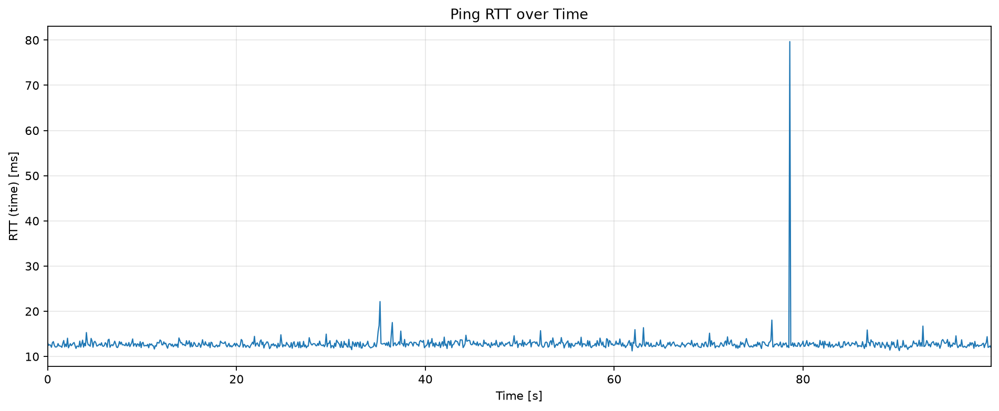
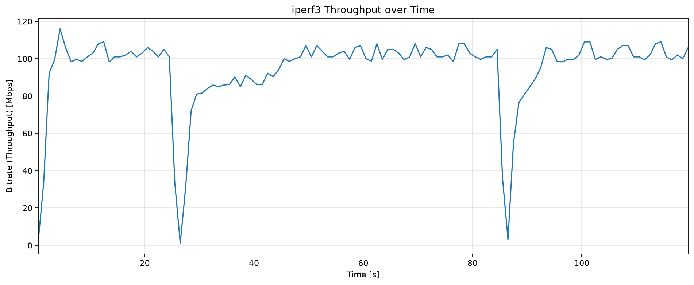
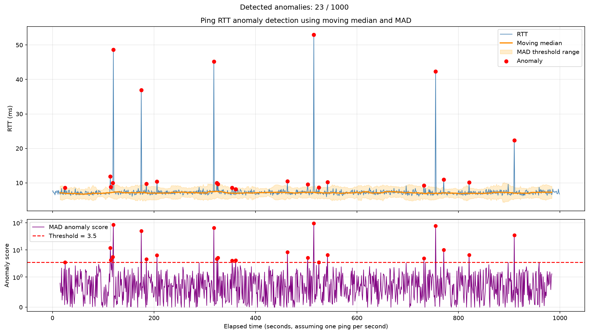

# Practice C: Python によるデータ分析
## 0. 想定動作環境
### OS
- Windows 11
- Linux (Ubuntu 24.04) ※推奨
- macOS 15 (Sequoia) or later ※推奨

### ネットワーク接続
- KU WiFi, 有線 (LAN) 接続, スマホテザリング ※ データ通信量を消費します

### Python
- version 3.14 を想定


## 1. Install Python
### 1.1 Windows(WSL/Ubuntu)
- WSL を起動し、Ubuntu ターミナル上で ```apt``` を用いてライブラリをインストール
```console
$ sudo apt update
$ sudo apt install python3 python3-pip
```
- インストールされた python のバージョンを確認
```console
$ python3 --version
Python 3.14.4
```
- となればインストール完了（一番右のマイナーバージョンが違ってもOK）
- python に必要なライブラリをインストール
```console
$ sudo apt install python3-numpy python3-pandas python3-scipy python3-matplotlib
```
<!-- ```console
$ pip3 install numpy pandas scipy ruptures scikit-learn matplotlib
``` -->
### 1.2 macOS
```console
brew install python@3.14
```


## 2. Visualization
### 2.1 matplotlib を用いた RTT のグラフ化
- 以下に python のグラフ化ライブラリ (matplotlib) を用いた RTT のグラフ化のサンプルコードを記載します。コメントアウトをよく読み、理解した上で使いましょう。[サンプルコード](./script/2-1-plot-ping-rtt.py) にも利用可能なコードを置いておきますので、これを参考に自分でグラフ化してみましょう。
- 実行方法は以下の通りです。
```console
$ python3 2-1-plot-ping-rtt.py log_file # log_file 部分には取得した ping データのファイル名 (例: ./ping2google.log など) を入力しましょう
```
- 以下のようなグラフ（横軸: 経過時間、縦軸: RTT）が出力されることを確認しましょう。


### 2.2 [sample script]
```python
#!/usr/bin/env python3
""" ping ログから RTT を抽出し、時間変化を折れ線グラフとして描画するプログラム

処理の流れ:
1. 各行から ``icmp_seq`` と ``time`` を正規表現で抽出
2. ``icmp_seq × 測定間隔`` により、sequence番号を経過時間へ変換
3. 経過時間を横軸、RTT [ms]を縦軸としてMatplotlibで描画
4. グラフをPNGファイルとして保存
"""

import argparse
import re
from pathlib import Path

import matplotlib.pyplot as plt


# ログ1行から必要な数値を取り出すための正規表現。
# ``?P<seq>`` と ``?P<rtt>`` は、後から名前で値を取得するためのグループ名
PING_PATTERN = re.compile(
    # 通常形式（time=12.3 ms）と簡略形式（time=12.3）の両方に対応
    r"icmp_seq=(?P<seq>\d+).*?time=(?P<rtt>[0-9.]+)(?:\s*ms)?"
)


def load_ping_log(log_path: Path) -> tuple[list[int], list[float]]:
    """pingログからicmp_seqとRTTを読み込み

    Parameters
    ----------
    log_path:
        読み込むpingログのパス

    Returns
    -------
    sequences:
        抽出したicmp_seqの一覧
    rtts:
        抽出したRTT [ms]の一覧
    """
    # 同じ位置の要素が対応する2つのリストとして保持
    # 例: sequences[0]のRTTはrtts[0]に格納
    sequences: list[int] = []
    rtts: list[float] = []

    # errors="ignore"により、ログに不正な文字が含まれても読み込みを継続
    with log_path.open("r", encoding="utf-8", errors="ignore") as log_file:
        for line in log_file:
            # 現在の行がping測定結果なら、seqとRTTを取得
            match = PING_PATTERN.search(line)
            if match:
                sequences.append(int(match.group("seq")))
                rtts.append(float(match.group("rtt")))

    # 対象行が1件もなければ、空のグラフを作らずエラーとして通知
    if not sequences:
        raise ValueError(f"RTTデータを抽出できませんでした: {log_path}")

    return sequences, rtts


def plot_rtt(
    sequences: list[int],
    rtts: list[float],
    interval_seconds: float,
    output_path: Path,
    show: bool,
) -> None:
    """RTTの時間変化を描画し、画像ファイルへ保存する。"""

    # sequence番号を経過時間[秒]へ変換
    # interval_seconds=0.1としているので、seq=10は1.0秒に変換
    # sequence番号を直接利用するため、途中のseqが欠けても時間位置はずれない
    elapsed_seconds = [seq * interval_seconds for seq in sequences]

    # 12×5インチの描画領域を作成する。
    fig, ax = plt.subplots(figsize=(12, 5))

    # 経過時間とRTTを折れ線で結ぶ
    ax.plot(
        elapsed_seconds,
        rtts,
        color="tab:blue",
        linewidth=1.0,
    )

    # タイトル、軸ラベル、補助線を設定
    ax.set_title("Ping RTT over Time")
    ax.set_xlabel("Time [s]")
    ax.set_ylabel("RTT (time) [ms]")
    ax.grid(True, alpha=0.3)

    # 横軸の表示範囲を最初から最後の測定時刻までに限定
    ax.set_xlim(elapsed_seconds[0], elapsed_seconds[-1])

    # ラベルが画像外にはみ出さないよう調整してからPNGとして保存
    fig.tight_layout()
    fig.savefig(output_path, dpi=160, bbox_inches="tight")

    # 処理結果を端末に表示
    print(f"samples={len(rtts)}")
    print(f"time_range={elapsed_seconds[0]:.1f}-{elapsed_seconds[-1]:.1f} s")
    print(f"output={output_path.resolve()}")

    # --showが指定された場合だけウィンドウを表示
    # 指定されていない場合は、使用した描画領域を明示的に解放
    if show:
        plt.show()
    else:
        plt.close(fig)


def main() -> None:
    """コマンドライン引数を処理し、ログの読み込みと描画を実行 """

    # argparseを使うことで、入力ファイルや出力先を実行時に変更可
    parser = argparse.ArgumentParser(
        description="Plot ping RTT with icmp_seq converted to elapsed time."
    )
    parser.add_argument("log_file", type=Path, help="pingログファイル")
    parser.add_argument(
        "--interval",
        type=float,
        default=0.1,
        help="1 icmp_seqあたりの秒数（今回は既定値: 0.1）",
    )
    parser.add_argument(
        "--output",
        type=Path,
        default=Path("ping-rtt-01s.png"),
        help="出力画像のパス",
    )
    parser.add_argument(
        "--show",
        action="store_true",
        help="保存後にグラフを画面表示",
    )
    args = parser.parse_args()

    # 0秒以下の測定間隔では時間軸を作れないため、事前に検査
    if args.interval <= 0:
        raise ValueError("--intervalには0より大きい値を指定してください。")

    # ログを読み込み
    sequences, rtts = load_ping_log(args.log_file)

    # 出力先のディレクトリが存在しない場合は自動的に作成
    args.output.parent.mkdir(parents=True, exist_ok=True)

    # 読み込んだデータをグラフ化
    plot_rtt(sequences, rtts, args.interval, args.output, args.show)


# このファイルが直接実行されたときだけmain()を呼び出す（他のPythonコードからimportされた時は自動実行されない）
if __name__ == "__main__":
    main()
```


### 2.3 matplotlib を用いた throughput のグラフ化
- 以下に python のグラフ化ライブラリ (matplotlib) を用いた RTT のグラフ化のサンプルコードを記載します。コメントアウトをよく読み、理解した上で使いましょう。[サンプルコード](./script/2-2-plot-iperf-thpt.py) にも利用可能なコードを置いておきますので、これを参考に自分でグラフ化してみましょう。
- 実行方法は以下の通りです。
```console
$ python3 plot-iperf-thpt.py log_file # log_file 部分には取得した iperf3 データのファイル名 (例: ./iperf.log など) を入力しましょう
- 以下のようなグラフ（横軸: 経過時間、縦軸: スループット）が出力されることを確認しましょう。

```

### 2.4 [sample script]
```python
#!/usr/bin/env python3
""" 1秒区間ごとのiperf3スループットを折れ線グラフに描画 """

import re
import sys
from pathlib import Path

import matplotlib.pyplot as plt


# 実行形式: python3 plot-iperf-thpt.py 入力ファイル [出力PNG]
if len(sys.argv) not in (2, 3):
    raise SystemExit(f"Usage: python {Path(sys.argv[0]).name} INPUT [OUTPUT.png]")

input_path = Path(sys.argv[1])
output_path = Path(sys.argv[2]) if len(sys.argv) == 3 else Path("iperf-throughput.png")

# 例「0.00-1.00 2.09」から開始時刻、終了時刻、Mbpsを抽出
pattern = re.compile(r"^\s*([0-9.]+)-([0-9.]+)\s+([0-9.]+)\s*$")
times, throughputs = [], []

with input_path.open(encoding="utf-8", errors="ignore") as log_file:
    for line in log_file:
        match = pattern.match(line)
        if not match:
            continue

        start, end, mbps = map(float, match.groups())

        # 各1秒区間の中央時刻を、その区間の代表時刻として利用
        times.append((start + end) / 2)
        throughputs.append(mbps)

if not throughputs:
    raise SystemExit("スループットデータを読み込めませんでした。")

# 横軸を時間、縦軸をスループットとして描画
fig, ax = plt.subplots(figsize=(12, 5))
ax.plot(times, throughputs, linewidth=1.4, color="tab:blue")
ax.set(
    title="iperf3 Throughput over Time",
    xlabel="Time [s]",
    ylabel="Bitrate (Throughput) [Mbps]",
)
ax.grid(alpha=0.3)
ax.set_xlim(times[0], times[-1])

# レイアウトを調整し、PNGとして保存
fig.tight_layout()
fig.savefig(output_path, dpi=160, bbox_inches="tight")
plt.close(fig)

print(f"samples={len(throughputs)}")
print(f"output={output_path.resolve()}")
```


## 3. Data Analytics
- 以下に python のデータ分析のライブラリ（numpy, pandas）を用いた RTT の MAD 異常検知のためのサンプルコードを記載します。コメントアウトをよく読み、理解した上で実行してみましょう。[サンプルコード](./script/3-plot-rtt-w-mad.py) に利用可能なコードを置いておきますので、これを参考に自分でグラフ化してみましょう。
- 実行方法は以下の通りです。
```console
$ python3 3-plot-rtt-w-mad.py log_file # log_file 部分には取得した ping データのファイル名 (例: ./ping2google.com.log など) を入力しましょう
```
- 以下のようなグラフ（横軸: 経過時間、縦軸: RTT/移動中央値など）が出力されることを確認しましょう。

### 3.1 [sample script]
```python
#!/usr/bin/env python3
""" 移動中央値とMADを使って、ping RTTの外れ値を検出・可視化

処理の流れ:
1. pingログからicmp_seqとRTTを読み込み
2. 各測定点の周辺にあるデータから移動中央値とMADを計算
3. 中央値から大きく離れたRTTを異常として判定
4. RTT、判定範囲、異常スコアをMatplotlibで可視化
"""

import argparse
import re
from pathlib import Path

import matplotlib.pyplot as plt
import numpy as np
import pandas as pd


def load_ping_log(log_path: Path) -> pd.DataFrame:
    """pingログからsequence番号とRTT [ms]を抽出
    ``icmp_seq=10`` と ``icmp_seq 10``、および
    ``time=12.3 ms`` と ``time<1 ms`` のような表記に対応
    """
    # 1番目のグループでicmp_seq、2番目のグループでRTTを取得
    pattern = re.compile(
        r"icmp_seq[= ](\d+).*?time[=<]([\d.]+)\s*ms"
    )

    records = []

    # 解釈できない文字がログ中にあっても処理を継続
    with log_path.open("r", encoding="utf-8", errors="ignore") as file:
        for line in file:
            match = pattern.search(line)

            # ping応答行だけを測定データとして追加
            if match:
                records.append(
                    {
                        "seq": int(match.group(1)),
                        "rtt": float(match.group(2)),
                    }
                )

    # 空のDataFrameを後続処理へ渡さず、原因が分かるエラーを出力
    if not records:
        raise ValueError("pingログからRTTを抽出できませんでした。")

    # sequence番号順に並べ、行番号を0から採番
    return pd.DataFrame(records).sort_values("seq").reset_index(drop=True)


def calculate_mad(values: np.ndarray) -> float:
    """Median Absolute Deviation（中央絶対偏差）を計算
    MADは 各値と中央値との差の絶対値について、さらに中央値を取った値で、
    平均値と標準偏差よりも大きな外れ値の影響を受けにくい
    """
    median = np.median(values)
    return np.median(np.abs(values - median))


def detect_anomalies(
    df: pd.DataFrame,
    window_size: int = 31,
    threshold: float = 3.5,
) -> pd.DataFrame:
    """移動中央値とMADを使ってRTTの異常を判定
    Parameters
    ----------
    df:
        ``seq``列と``rtt``列を持つ測定データ
    window_size:
        各測定点の前後を評価する移動窓（ウィンドウ）の大きさで、中央窓なので奇数に設定
    threshold:
        Robust Z-score がこの値を超えた測定点を異常と検知
    """
    # 中央点と周辺データを含めるため、最低3点が必要
    if window_size < 3:
        raise ValueError("window_sizeは3以上にしてください。")

    # 偶数では窓の中央が1点に決まらないため、奇数だけを許可
    if window_size % 2 == 0:
        raise ValueError("中央移動窓を使うため、window_sizeは奇数にしてください。")

    # 入力DataFrameを変更しないよう、分析用のコピーを作成
    result = df.copy()

    # 各点を中心としたwindow_size件のRTTについて中央値を計算
    # 端では窓のデータ数が不足するため、結果は対象外 (NaN: Not a Number)
    result["rolling_median"] = (
        result["rtt"]
        .rolling(
            window=window_size,
            center=True,
            min_periods=window_size,
        )
        .median()
    )

    # 同じ移動窓についてMADを計算
    # raw=Trueにより、calculate_madにはNumPy配列を譲渡
    result["rolling_mad"] = (
        result["rtt"]
        .rolling(
            window=window_size,
            center=True,
            min_periods=window_size,
        )
        .apply(calculate_mad, raw=True)
    )

    # 正規分布を仮定した標準偏差に近い尺度へMADを変換
    # 1.4826は正規分布におけるMADの補正係数
    result["robust_sigma"] = 1.4826 * result["rolling_mad"]

    # MADが0の窓では除算できないため、一時的にNaNへ置き換え
    safe_sigma = result["robust_sigma"].replace(0, np.nan)

    # RTTが移動中央値から何sigma離れているかを表すRobust Z-score
    result["anomaly_score"] = (
        (result["rtt"] - result["rolling_median"]).abs()
        / safe_sigma
    )

    # グラフ表示用に、正常とみなすRTTの下限と上限を計算
    result["lower_limit"] = (
        result["rolling_median"]
        - threshold * result["robust_sigma"]
    )
    result["upper_limit"] = (
        result["rolling_median"]
        + threshold * result["robust_sigma"]
    )

    # スコアが指定した閾値を超えた測定点を異常と判断
    result["is_anomaly"] = result["anomaly_score"] > threshold

    return result


def plot_results(
    df: pd.DataFrame,
    threshold: float,
    output_path: Path,
) -> None:
    """RTTの判定結果と異常スコアを2段のグラフにする"""
    # 異常点だけを抽出し、赤い点として重ねて表示する
    anomalies = df[df["is_anomaly"]]

    # Matplotlibへ渡しやすいよう各列をNumPy配列に変換
    x = df["seq"].to_numpy()
    rtt = df["rtt"].to_numpy()
    rolling_median = df["rolling_median"].to_numpy()
    lower_limit = df["lower_limit"].to_numpy()
    upper_limit = df["upper_limit"].to_numpy()
    anomaly_score = df["anomaly_score"].to_numpy()

    # 上段をRTT、下段を異常スコアとして、横軸を共有
    fig, axes = plt.subplots(
        2,
        1,
        figsize=(14, 8),
        sharex=True,
        gridspec_kw={"height_ratios": [2, 1]},
    )

    # --- 上段: RTT、移動中央値、正常範囲、異常点 ---
    axes[0].plot(x, rtt, color="steelblue", linewidth=1, label="RTT")
    axes[0].plot(
        x,
        rolling_median,
        color="darkorange",
        linewidth=2,
        label="Moving median",
    )
    axes[0].fill_between(
        x,
        lower_limit,
        upper_limit,
        color="orange",
        alpha=0.2,
        label="MAD threshold range",
    )
    axes[0].scatter(
        anomalies["seq"],
        anomalies["rtt"],
        color="red",
        marker="o",
        s=35,
        zorder=5,
        label="Anomaly",
    )
    axes[0].set_title("Ping RTT anomaly detection using moving median and MAD")
    axes[0].set_ylabel("RTT (ms)")
    axes[0].grid(True, alpha=0.3)
    axes[0].legend()

    # --- 下段: Robust Z-scoreと異常判定の閾値 ---
    axes[1].plot(
        x,
        anomaly_score,
        color="purple",
        linewidth=1,
        label="MAD anomaly score",
    )
    axes[1].axhline(
        threshold,
        color="red",
        linestyle="--",
        linewidth=1.5,
        label=f"Threshold = {threshold}",
    )
    axes[1].scatter(
        anomalies["seq"],
        anomalies["anomaly_score"],
        color="red",
        s=30,
        zorder=5,
    )

    # 通常の対数軸と異なり、0付近も表示できるsymlogを使用
    # 大きな異常スコアがあっても、通常範囲の変化を読み取りやすくする
    axes[1].set_yscale("symlog", linthresh=1)
    axes[1].set_xlabel(
        "Elapsed time (seconds, assuming one ping per second)"
    )
    axes[1].set_ylabel("Anomaly score")
    axes[1].grid(True, alpha=0.3)
    axes[1].legend()

    # グラフ全体のタイトルに異常数と全測定数を表示
    fig.suptitle(
        f"Detected anomalies: {len(anomalies)} / {len(df)}",
        fontsize=12,
    )

    # レイアウトを整え、指定された画像ファイルへ保存
    plt.tight_layout()
    plt.savefig(output_path, dpi=150, bbox_inches="tight")
    plt.show()


def main() -> None:
    """引数を読み込み、ログ解析・異常検出・可視化を順に実行"""
    parser = argparse.ArgumentParser(
        description="Detect ping RTT anomalies using moving median and MAD."
    )

    # 入力ログは必須の位置引数として受け取り
    parser.add_argument(
        "log_file",
        type=Path,
        help="Path to the ping log file",
    )

    # 移動窓と判定閾値は必要に応じてコマンドラインから変更可能
    parser.add_argument(
        "--window",
        type=int,
        default=31,
        help="Moving-window size; must be odd (default: 31)",
    )
    parser.add_argument(
        "--threshold",
        type=float,
        default=3.5,
        help="Anomaly-score threshold (default: 3.5)",
    )
    parser.add_argument(
        "--output",
        type=Path,
        default=Path("ping_rtt_mad.png"),
        help="Output image path",
    )
    args = parser.parse_args()

    # 1. pingログをDataFrameへ読み込み
    df = load_ping_log(args.log_file)

    # 2. 移動中央値とMADを計算して異常を判定
    result = detect_anomalies(
        df,
        window_size=args.window,
        threshold=args.threshold,
    )

    # 3. 検出結果を端末へ表示
    anomalies = result[result["is_anomaly"]]
    print(f"測定数: {len(result)}")
    print(f"異常検出数: {len(anomalies)}")

    if not anomalies.empty:
        print("\n検出された異常:")
        print(
            anomalies[
                ["seq", "rtt", "rolling_median", "anomaly_score"]
            ].to_string(index=False)
        )

    # 4. 分析結果をグラフ化して保存
    plot_results(
        result,
        threshold=args.threshold,
        output_path=args.output,
    )


if __name__ == "__main__":
    main()

```